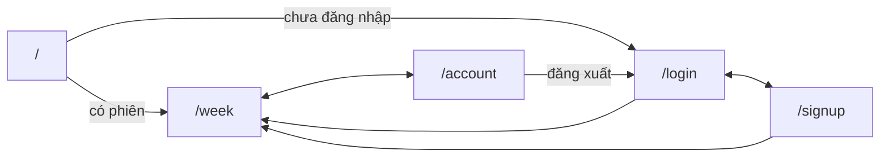
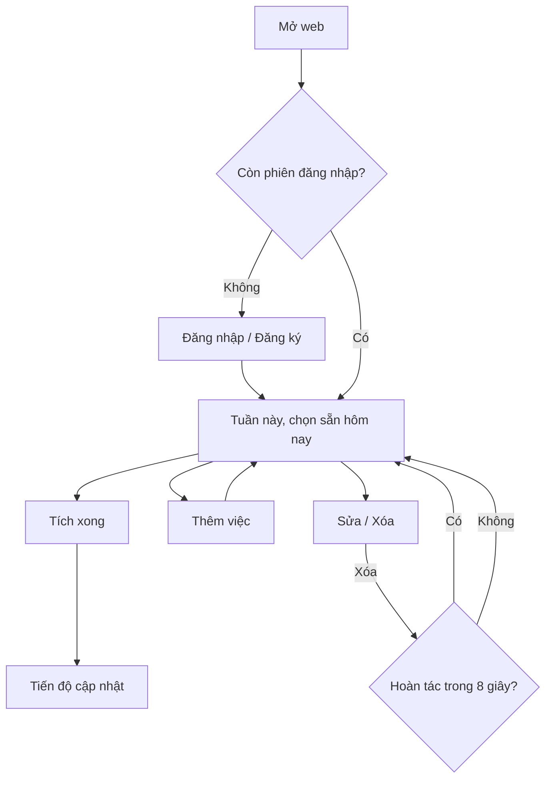

# Ai Planner – Kiến trúc thiết kế (Phase 3)

Hướng thiết kế đã chọn: **B · Giấy kẻ ô**. Web là một cuốn sổ kế hoạch tuần, mỗi người một tài khoản, dữ liệu lưu trên máy chủ.

## 1. Sơ đồ trang

| Đường dẫn | Trang | Ai xem được |
| --- | --- | --- |
| `/` | Chuyển tới `/week` nếu đã đăng nhập, ngược lại tới `/login` | Mọi người |
| `/login` | Đăng nhập | Chưa đăng nhập |
| `/signup` | Đăng ký (cần mã mời nếu máy chủ đặt `INVITE_CODE`) | Chưa đăng nhập |
| `/week` | Tuần đang chọn. `?d=YYYY-MM-DD` mở tuần chứa ngày đó | Đã đăng nhập |
| `/account` | Tên, mật khẩu, giao diện sáng/tối, sao lưu và nhập file, đăng xuất | Đã đăng nhập |



## 2. Luồng sử dụng

1. **Lần đầu:** `/signup` → nhập tên, email, mật khẩu (và mã mời nếu có), tùy chọn “Ghi nhớ đăng nhập” → vào `/week`, hôm nay được chọn sẵn. Ngày trống có lời nhắc thêm việc đầu tiên.
2. **Mỗi ngày:** mở web → thấy hôm nay → tích việc đã xong → thanh tiến độ tuần cập nhật ngay.
3. **Lập kế hoạch:** chọn ngày → nhập tên việc, giờ bắt đầu (tùy chọn) → Thêm. Bấm vào việc để sửa tên, giờ, ngày.
4. **Xóa:** trong hộp sửa bấm Xóa → việc biến mất, thanh thông báo có nút **Hoàn tác** trong 8 giây.
5. **Chuyển thiết bị:** đăng nhập trên điện thoại hoặc máy khác → cùng dữ liệu.
6. **Chuyển từ bản cũ:** Tài khoản → Nhập file → chọn file sao lưu của bản một file (`ke-hoach-*.json`) → việc và ghi chú được **thêm vào**, không ghi đè dữ liệu đang có.



## 3. Wireframe

**Điện thoại (dưới 900px):** một ngày một trang, chọn ngày bằng dải 7 ô.

```
┌────────────────────────────────┐
│ ▣ Ai Planner          ☾   (B)  │  logo · sáng/tối · tài khoản
│ Tuần 48 · 23/11 – 29/11/2026   │
│ ‹ Tuần trước   Tuần này   Sau ›│
│ 4/11 việc · 36%   Tuần trước 78%│
│ ██████░░░░░░░░░░░░             │
│ [T2][T3][T4][T5][T6][T7][CN]   │  dải ngày, chấm = số việc
│ ┌────────────────────────────┐ │
│ │ Thứ Tư, 25/11 · Hôm nay    │ │  trang của ngày
│ │ ☐ 09:30  Trả lời email  Trễ│ │
│ │ ☑ 11:00  Gửi báo cáo   Xong│ │
│ │ [Thêm việc…] [--:--] [Thêm]│ │
│ └────────────────────────────┘ │
│ Mục tiêu tuần   [...........]  │
│ Ghi chú         [...........]  │
└────────────────────────────────┘
```

**Máy tính (từ 900px):** cột trái là tổng quan tuần, bên phải trải đủ 7 trang ngày.

```
┌───────────────────────────────────────────────────────────────────┐
│ ▣ Ai Planner    ‹  Tuần 48 · 23/11 – 29/11/2026  ›  Tuần này  ☾ (B)│
├────────────────┬──────────────────────────────────────────────────┤
│ Tiến độ  36%   │ ┌Thứ Hai 23┐ ┌Thứ Ba 24─┐ ┌Thứ Tư 25─┐ ┌Thứ Năm 26┐ │
│ 4/11 việc      │ │☑ 08:00 … │ │☑ 17:30 … │ │☐ 09:30 … │ │☐ 20:00 … │ │
│ Tuần trước 78% │ │ + Thêm   │ │ + Thêm   │ │ + Thêm   │ │ + Thêm   │ │
│ Mục tiêu tuần  │ └──────────┘ └──────────┘ └──────────┘ └──────────┘ │
│ Ghi chú        │ ┌Thứ Sáu 27┐ ┌Thứ Bảy 28┐ ┌Chủ Nhật 29┐            │
└────────────────┴──────────────────────────────────────────────────┘
```

## 4. Hệ thống thiết kế

**Màu** (mọi màu là biến CSS, nền tối được thiết kế riêng chứ không đảo màu):

| Biến | Sáng | Tối | Dùng cho |
| --- | --- | --- | --- |
| `--paper` | `#F3F6F9` | `#0F1727` | Nền trang |
| `--grid` | `#E2E9F1` | `#172238` | Ô kẻ trên nền |
| `--sheet` | `#FCFDFE` | `#121C2F` | Trang ngày, thẻ |
| `--ink` | `#1B2A4A` | `#E4EAF5` | Chữ chính, nút chính |
| `--ink-2` | `#58698A` | `#97A6C2` | Chữ phụ |
| `--rule` | `#D3DCE8` | `#2A3854` | Đường kẻ |
| `--hl` | `#D9F36B` | `#4A5D10` | Bút dạ quang (việc xong) |
| `--hl-ink` | `#1B2A4A` | `#F2F7DC` | Chữ trên dạ quang |
| `--ok` | `#3B6C1D` | `#B6D94C` | Trạng thái xong |
| `--late` | `#C23B33` | `#FF7D72` | Bút đỏ: việc trễ, lỗi |

Mọi cặp chữ/nền đạt tương phản WCAG AA (tối thiểu 4.5:1 cho chữ thường).

**Chữ:** Be Vietnam Pro (thiết kế cho tiếng Việt) cho mọi chữ, IBM Plex Mono cho giờ và số. Thang cỡ: 12 · 13 · 14 · 16 · 18 · 22 · 28 · 36px. Tiêu đề đậm 800, chữ thường 400–500, số dùng `tabular-nums`.

**Khoảng cách:** bội số 4px (4, 8, 12, 16, 20, 24, 32, 40, 56). **Bo góc:** 8px (ô nhập), 12px (ô ngày), 16px (trang ngày). **Bóng:** chỉ trang ngày có bóng giấy nhẹ.

**Chuyển động:** 120ms cho phản hồi bấm, 240ms cho bố cục, 450ms cho nét bút dạ quang và dấu tích. Tắt hết khi máy bật “giảm chuyển động”.

**Biểu tượng:** Lucide (nét 1.75px). Không dùng emoji làm biểu tượng.

**Truy cập:** điều khiển được bằng bàn phím, viền focus rõ, vùng bấm tối thiểu 40px trên điện thoại, nhãn cho trình đọc màn hình, hộp thoại dùng `<dialog>` gốc.

## 5. Kiến trúc component

```
src/app
  layout.tsx            font, script đặt sáng/tối trước khi vẽ (không nháy màu)
  page.tsx              chuyển hướng theo phiên
  login/ signup/        AuthShell + AuthForm
  week/page.tsx         máy chủ kiểm tra phiên → <WeekApp>
  account/page.tsx      máy chủ kiểm tra phiên → <AccountPanel>
  api/…                 route handlers (bên dưới)
src/components
  brand/Logo            biểu tượng lịch có dấu tích
  auth/AuthShell, AuthForm
  shell/AppHeader, ThemeToggle
  week/WeekApp          giữ dữ liệu tuần, gọi API, cập nhật lạc quan
       WeekNav, ProgressCard, DayStrip, DayPage, TaskRow, AddTaskForm,
       EditTaskDialog, WeekNotes, UndoToast
  account/AccountPanel, ProfileForm, PasswordForm, BackupPanel
src/lib                 dates.ts (tuần, giờ Việt Nam), status.ts, api.ts, validation.ts, backup.ts
src/server              db/schema.ts, auth.ts, http.ts, errors.ts, rate-limit.ts,
                        services/account.ts, tasks.ts, weeks.ts, backup.ts
```

## 6. Dữ liệu và API

**Bảng:** `users` (email, tên, mật khẩu đã băm, giao diện), `sessions` (băm SHA-256 của mã phiên, cờ `remember`), `rate_limits`, `tasks` (ngày, tên, giờ bắt đầu/kết thúc, xong lúc nào), `week_notes` (mục tiêu và ghi chú theo tuần).

| Phương thức | Đường dẫn | Việc |
| --- | --- | --- |
| POST | `/api/auth/signup` · `/login` · `/logout` | Đăng ký, đăng nhập (kèm `remember`), đăng xuất |
| GET / PATCH | `/api/me` | Đọc tài khoản, đổi tên hoặc giao diện |
| POST | `/api/me/password` | Đổi mật khẩu, đăng xuất các thiết bị khác |
| GET / PUT | `/api/weeks/:monday` | Việc trong tuần + tiến độ tuần trước; lưu mục tiêu, ghi chú |
| POST | `/api/tasks` | Thêm việc |
| PATCH / DELETE | `/api/tasks/:id` | Sửa, tích xong, xóa |
| GET / POST | `/api/backup` | Tải bản sao lưu; nhập file (bản cũ hoặc bản mới) |

## 7. Bảo mật

- Mật khẩu băm bằng scrypt; cơ sở dữ liệu chỉ giữ SHA-256 của mã phiên.
- Cookie phiên `httpOnly`, `SameSite=Lax`, tiền tố `__Host-` khi chạy thật. “Ghi nhớ đăng nhập”: 30 ngày và tự gia hạn; nếu không chọn: cookie phiên, hạn 24 giờ, không gia hạn (cột `sessions.remember`).
- Mọi yêu cầu thay đổi dữ liệu phải cùng nguồn (chặn CSRF); giới hạn số lần đăng nhập, đăng ký.
- Mọi truy vấn đều lọc theo người đang đăng nhập; mã việc của người khác trả về “không tìm thấy”.
- Content-Security-Policy, HSTS, chặn nhúng khung khi chạy thật. Không có khóa bí mật nào trong mã nguồn.
